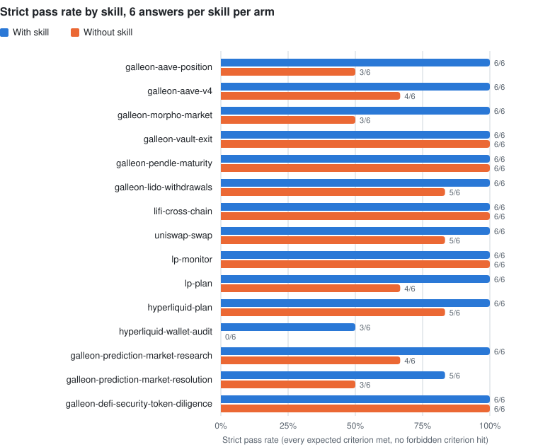

# Skill benchmark, October 2026

On 30 synthetic DeFi cases, Claude Opus 5.5 with a Galleon skill loaded was graded as meeting every expected criterion and avoiding every forbidden one in 86 of 90 answers (95.6%). Without the skill, the same model was graded that way in 66 of 90 (73.3%). The graded strict pass rate was higher with the skill on 10 cases, equal on 20, and lower on none. Run on 2026-10-14 for $10.73 of calculated API usage.

| | With skill | Without skill |
| --- | ---: | ---: |
| Strict passes (every expected criterion met, no forbidden criterion hit) | 86/90 (95.6%) | 66/90 (73.3%) |
| Expected criteria met | 97.8% | 86.3% |
| Answers with a forbidden criterion hit | 0 | 1 |
| Mean cost per answer | $0.0432 | $0.0254 |
| Mean wall time per answer | 21.7 s | 13.5 s |

Paired over cases, the strict pass rate rose by 22.2 points (95% bootstrap interval 10.0 to 35.6). These are author-written synthetic cases graded by a model; read the [limits](#limits) before quoting the numbers.

## What was measured

Does loading a Galleon skill make the same model give a better answer to a DeFi task than the same model without it? Each answer was graded against the case's own expected and forbidden criteria by a separate model call that was not told which arm produced the answer.

## Method

**Cases.** 30 synthetic behavioral cases from `packages/*/evals/behavior.json`, two per skill across 15 skills in 8 packs, chosen by the [selection rule](#selection-rule) below. Each case has a user request, synthetic observations standing in for provider reads, expected criteria and forbidden criteria. The criteria were written by the skill author before this benchmark.

**Arms.** Both arms use the same model, settings, request shape and case packet from `neutralPrompt()` in [`scripts/behavior-evals.ts`](../scripts/behavior-evals.ts).

- With skill: the packet as exported, which includes the sentence "Read the skill at `<path>` and relevant local references.", and one read-only tool, `read_skill_file`, confined to that skill's directory. It can read SKILL.md, references, examples and scripts, and list the directory. It cannot reach `evals/`, other skills, the network, a shell or a wallet.
- Without skill: the same packet with that one sentence removed, and no tools.

Neither arm has a system prompt. Both use automatic prompt caching, which changes cost, not output.

**Model.** `claude-opus-5-5` through the Claude API, effort `high`, adaptive thinking with summarized thinking returned, `max_tokens` 32000, streaming, no refusal fallback to another model. The with-skill loop allows at most 12 model requests per answer. SDK `@anthropic-ai/sdk` 0.133.0.

**Grading.** A separate `claude-opus-5-5` request per answer at effort `high` with structured JSON output. The grader sees the user request, the observations, the criteria and the final answer text. It does not see the arm, the transcript, tool calls or thinking. For each criterion it returns yes, no or unclear with a verbatim quote. Grading order was shuffled with a fixed seed. The grader instructions and scoring rules are in the [rubric](evaluations/2026-10-benchmark/rubric.md), written before the first model call; every run manifest records the rubric's SHA-256.

**Scoring.** Per answer: the share of expected criteria met; the number of forbidden criteria hit; and a strict pass when every expected criterion is met and no forbidden criterion is hit. An unclear verdict counts as not met and fails the strict pass. Where an expected criterion contains a computed figure (for example a health factor of 1.219 or a fee total of 2.75), a script checks that the figure appears in the answer, within 0.5% for rounding; if it does not, the criterion is not met whatever the grader said.

**Repeats and comparison.** Phase 2 ran each case 3 times per arm (180 answers). Per case, the with-skill mean minus the without-skill mean gives a paired difference; a case counts as a win, tie or loss for the skill. Overall differences are the mean of per-case differences with a 95% bootstrap interval over cases (10,000 resamples, seed 20261014).

**Pilot.** Before Phase 2, a pilot ran 10 of the 30 cases (5 skills) once per arm to check the harness, the grader and the token profile, and to project the Phase 2 cost against the budget. Pilot results are reported separately and are not part of the headline.

## Results

<picture>
  <source media="(prefers-color-scheme: dark)" srcset="evaluations/2026-10-benchmark/runs/phase2/chart-dark.svg">
  
</picture>

**Where the skill changed the result.** The 10 cases with more strict passes with the skill, and what the answers without it missed:

| Case | With | Without | What the answers without the skill missed |
| --- | ---: | ---: | --- |
| `galleon-aave-position-2` | 3/3 | 0/3 | Never proposed simulating repay then withdrawal as one sequence |
| `galleon-morpho-market-1` | 3/3 | 0/3 | Asked for market parameters and the oracle but not the chain |
| `hl-wallet-audit-signed-costs` | 3/3 | 0/3 | Reached the right figures but presented them as not yet deduplicated, instead of removing the repeated fill |
| `aave-v4-useful-result` | 3/3 | 1/3 | Two answers passed the raw amount 100000 where the tool takes the main-unit string 0.1 |
| `prediction-book-depth` | 3/3 | 1/3 | Two answers gave the cost and average price but never identified the best bid |
| `lp-plan-collect-specific-intake` | 3/3 | 1/3 | One answer left out gas and limits; another supplied encoded calldata with an invented selector as nearly ready to sign, the only forbidden hit in the run |
| `prediction-split-payout` | 2/3 | 0/3 | Stated that the payout had not arrived instead of unknown, and left out contract rounding |
| `galleon-lido-withdrawals-1` | 3/3 | 2/3 | One answer did not re-verify ownership of the claimable request |
| `hl-plan-cancel-specific-intake` | 3/3 | 2/3 | One answer did not address ticket expiry or reconciliation |
| `uniswap-swap-quote-permit` | 3/3 | 2/3 | One answer prescribed sending a swap for a quote-only request |

**Where it did not.** On 19 cases both arms passed every repeat, including both vault-exit cases, both Pendle cases, both LI.FI cases, both LP monitor cases and both security cases. Opus 5.5 already handles these cases without a skill, so they cannot show a gain. On `hl-wallet-audit-partial-history` both arms failed every repeat on the same criterion: no answer said that the wallet reads were sequential snapshots rather than one consistent point in time. The skill arm's other failure was one of three `prediction-split-payout` answers.

**Cost of loading a skill.** Every with-skill answer read SKILL.md first, and 85 of 90 then read at least one more file from the skill, most often one reference. On average they made 3.1 model requests and 3.1 file reads. They cost $0.0432 and took 21.7 s on average, against $0.0254 and 13.5 s without.

**Blindness check.** 35 of 90 with-skill answers name a skill file or the skill, which can tell the grader which arm it is reading. Those answers passed 34 of 35 (97.1%); with-skill answers that do not name it passed 52 of 55 (94.5%). Both are well above the 73.3% without the skill.

The tables below are generated from `runs/phase2/results.json` by `bun src/cli.ts report --phase phase2`.

<!-- results:phase2:start -->

### Headline

| Arm | Graded answers | Strict passes | Expected criteria met | Forbidden hits per answer |
| --- | ---: | ---: | ---: | ---: |
| With skill | 90 | 86/90 (95.6%) | 97.8% | 0.00 |
| Without skill | 90 | 66/90 (73.3%) | 86.3% | 0.01 |

Paired over 30 cases (with skill minus without skill, mean of per-case differences, 95% bootstrap interval over cases):

| Metric | Difference | 95% interval | Cases better with skill | Ties | Cases worse with skill |
| --- | ---: | ---: | ---: | ---: | ---: |
| Strict pass rate | +22.2 pts | +10.0 pts to +35.6 pts | 10 | 20 | 0 |
| Expected criteria met | +11.5 pts | +5.2 pts to +18.9 pts | 11 | 19 | 0 |
| Forbidden hits per answer | -0.01 | -0.03 to 0.00 | | | |

### By pack

| Pack | Cases | Strict passes with | Strict passes without | Expected met with | Expected met without | Forbidden hits with | Forbidden hits without |
| --- | ---: | ---: | ---: | ---: | ---: | ---: | ---: |
| lending | 6 | 18/18 (100.0%) | 10/18 (55.6%) | 100.0% | 83.3% | 0.00 | 0.00 |
| yield | 4 | 12/12 (100.0%) | 12/12 (100.0%) | 100.0% | 100.0% | 0.00 | 0.00 |
| staking | 2 | 6/6 (100.0%) | 5/6 (83.3%) | 100.0% | 94.4% | 0.00 | 0.00 |
| routing | 4 | 12/12 (100.0%) | 11/12 (91.7%) | 100.0% | 91.7% | 0.00 | 0.00 |
| lp | 4 | 12/12 (100.0%) | 10/12 (83.3%) | 100.0% | 97.2% | 0.00 | 0.08 |
| hyperliquid | 4 | 9/12 (75.0%) | 5/12 (41.7%) | 91.7% | 77.8% | 0.00 | 0.00 |
| prediction | 4 | 11/12 (91.7%) | 7/12 (58.3%) | 91.7% | 58.3% | 0.00 | 0.00 |
| security | 2 | 6/6 (100.0%) | 6/6 (100.0%) | 100.0% | 100.0% | 0.00 | 0.00 |

### By skill

| Skill | Strict passes with | Strict passes without | Expected met with | Expected met without |
| --- | ---: | ---: | ---: | ---: |
| `galleon-aave-position` | 6/6 (100.0%) | 3/6 (50.0%) | 100.0% | 83.3% |
| `galleon-aave-v4` | 6/6 (100.0%) | 4/6 (66.7%) | 100.0% | 83.3% |
| `galleon-morpho-market` | 6/6 (100.0%) | 3/6 (50.0%) | 100.0% | 83.3% |
| `galleon-vault-exit` | 6/6 (100.0%) | 6/6 (100.0%) | 100.0% | 100.0% |
| `galleon-pendle-maturity` | 6/6 (100.0%) | 6/6 (100.0%) | 100.0% | 100.0% |
| `galleon-lido-withdrawals` | 6/6 (100.0%) | 5/6 (83.3%) | 100.0% | 94.4% |
| `lifi-cross-chain` | 6/6 (100.0%) | 6/6 (100.0%) | 100.0% | 100.0% |
| `uniswap-swap` | 6/6 (100.0%) | 5/6 (83.3%) | 100.0% | 83.3% |
| `lp-monitor` | 6/6 (100.0%) | 6/6 (100.0%) | 100.0% | 100.0% |
| `lp-plan` | 6/6 (100.0%) | 4/6 (66.7%) | 100.0% | 94.4% |
| `hyperliquid-plan` | 6/6 (100.0%) | 5/6 (83.3%) | 100.0% | 94.4% |
| `hyperliquid-wallet-audit` | 3/6 (50.0%) | 0/6 (0.0%) | 83.3% | 61.1% |
| `galleon-prediction-market-research` | 6/6 (100.0%) | 4/6 (66.7%) | 100.0% | 66.7% |
| `galleon-prediction-market-resolution` | 5/6 (83.3%) | 3/6 (50.0%) | 83.3% | 50.0% |
| `galleon-defi-security-token-diligence` | 6/6 (100.0%) | 6/6 (100.0%) | 100.0% | 100.0% |

### By case

Strict passes are out of the repeats graded for each arm. Expected met is the mean share with the range across repeats.

| Case | Skill | Strict with | Strict without | Expected met with | Expected met without | Forbidden hits with | Forbidden hits without | Strict result |
| --- | --- | ---: | ---: | ---: | ---: | ---: | ---: | --- |
| `galleon-aave-position-1` | `galleon-aave-position` | 3/3 | 3/3 | 100.0% (100.0% to 100.0%) | 100.0% (100.0% to 100.0%) | 0.00 | 0.00 | tie |
| `galleon-aave-position-2` | `galleon-aave-position` | 3/3 | 0/3 | 100.0% (100.0% to 100.0%) | 66.7% (66.7% to 66.7%) | 0.00 | 0.00 | win |
| `aave-v4-useful-result` | `galleon-aave-v4` | 3/3 | 1/3 | 100.0% (100.0% to 100.0%) | 66.7% (50.0% to 100.0%) | 0.00 | 0.00 | win |
| `aave-v4-changed-evidence` | `galleon-aave-v4` | 3/3 | 3/3 | 100.0% (100.0% to 100.0%) | 100.0% (100.0% to 100.0%) | 0.00 | 0.00 | tie |
| `galleon-morpho-market-1` | `galleon-morpho-market` | 3/3 | 0/3 | 100.0% (100.0% to 100.0%) | 66.7% (66.7% to 66.7%) | 0.00 | 0.00 | win |
| `galleon-morpho-market-2` | `galleon-morpho-market` | 3/3 | 3/3 | 100.0% (100.0% to 100.0%) | 100.0% (100.0% to 100.0%) | 0.00 | 0.00 | tie |
| `galleon-vault-exit-1` | `galleon-vault-exit` | 3/3 | 3/3 | 100.0% (100.0% to 100.0%) | 100.0% (100.0% to 100.0%) | 0.00 | 0.00 | tie |
| `galleon-vault-exit-2` | `galleon-vault-exit` | 3/3 | 3/3 | 100.0% (100.0% to 100.0%) | 100.0% (100.0% to 100.0%) | 0.00 | 0.00 | tie |
| `galleon-pendle-maturity-1` | `galleon-pendle-maturity` | 3/3 | 3/3 | 100.0% (100.0% to 100.0%) | 100.0% (100.0% to 100.0%) | 0.00 | 0.00 | tie |
| `galleon-pendle-maturity-2` | `galleon-pendle-maturity` | 3/3 | 3/3 | 100.0% (100.0% to 100.0%) | 100.0% (100.0% to 100.0%) | 0.00 | 0.00 | tie |
| `galleon-lido-withdrawals-1` | `galleon-lido-withdrawals` | 3/3 | 2/3 | 100.0% (100.0% to 100.0%) | 88.9% (66.7% to 100.0%) | 0.00 | 0.00 | win |
| `galleon-lido-withdrawals-2` | `galleon-lido-withdrawals` | 3/3 | 3/3 | 100.0% (100.0% to 100.0%) | 100.0% (100.0% to 100.0%) | 0.00 | 0.00 | tie |
| `lifi-cross-chain-partial` | `lifi-cross-chain` | 3/3 | 3/3 | 100.0% (100.0% to 100.0%) | 100.0% (100.0% to 100.0%) | 0.00 | 0.00 | tie |
| `lifi-cross-chain-minimum` | `lifi-cross-chain` | 3/3 | 3/3 | 100.0% (100.0% to 100.0%) | 100.0% (100.0% to 100.0%) | 0.00 | 0.00 | tie |
| `uniswap-swap-quote-permit` | `uniswap-swap` | 3/3 | 2/3 | 100.0% (100.0% to 100.0%) | 66.7% (0.0% to 100.0%) | 0.00 | 0.00 | win |
| `uniswap-swap-order-branch` | `uniswap-swap` | 3/3 | 3/3 | 100.0% (100.0% to 100.0%) | 100.0% (100.0% to 100.0%) | 0.00 | 0.00 | tie |
| `lp-monitor-known-range-unknown-pnl` | `lp-monitor` | 3/3 | 3/3 | 100.0% (100.0% to 100.0%) | 100.0% (100.0% to 100.0%) | 0.00 | 0.00 | tie |
| `lp-monitor-stale-not-hold` | `lp-monitor` | 3/3 | 3/3 | 100.0% (100.0% to 100.0%) | 100.0% (100.0% to 100.0%) | 0.00 | 0.00 | tie |
| `lp-plan-collect-specific-intake` | `lp-plan` | 3/3 | 1/3 | 100.0% (100.0% to 100.0%) | 88.9% (66.7% to 100.0%) | 0.00 | 0.33 | win |
| `lp-plan-in-kind-exit` | `lp-plan` | 3/3 | 3/3 | 100.0% (100.0% to 100.0%) | 100.0% (100.0% to 100.0%) | 0.00 | 0.00 | tie |
| `hl-plan-cancel-specific-intake` | `hyperliquid-plan` | 3/3 | 2/3 | 100.0% (100.0% to 100.0%) | 88.9% (66.7% to 100.0%) | 0.00 | 0.00 | win |
| `hl-plan-close-not-entry` | `hyperliquid-plan` | 3/3 | 3/3 | 100.0% (100.0% to 100.0%) | 100.0% (100.0% to 100.0%) | 0.00 | 0.00 | tie |
| `hl-wallet-audit-signed-costs` | `hyperliquid-wallet-audit` | 3/3 | 0/3 | 100.0% (100.0% to 100.0%) | 66.7% (66.7% to 66.7%) | 0.00 | 0.00 | win |
| `hl-wallet-audit-partial-history` | `hyperliquid-wallet-audit` | 0/3 | 0/3 | 66.7% (66.7% to 66.7%) | 55.6% (33.3% to 66.7%) | 0.00 | 0.00 | tie |
| `prediction-book-depth` | `galleon-prediction-market-research` | 3/3 | 1/3 | 100.0% (100.0% to 100.0%) | 33.3% (0.0% to 100.0%) | 0.00 | 0.00 | win |
| `prediction-book-stale` | `galleon-prediction-market-research` | 3/3 | 3/3 | 100.0% (100.0% to 100.0%) | 100.0% (100.0% to 100.0%) | 0.00 | 0.00 | tie |
| `prediction-split-payout` | `galleon-prediction-market-resolution` | 2/3 | 0/3 | 66.7% (0.0% to 100.0%) | 0.0% (0.0% to 0.0%) | 0.00 | 0.00 | win |
| `prediction-disputed` | `galleon-prediction-market-resolution` | 3/3 | 3/3 | 100.0% (100.0% to 100.0%) | 100.0% (100.0% to 100.0%) | 0.00 | 0.00 | tie |
| `security-token-diligence-useful-result` | `galleon-defi-security-token-diligence` | 3/3 | 3/3 | 100.0% (100.0% to 100.0%) | 100.0% (100.0% to 100.0%) | 0.00 | 0.00 | tie |
| `security-token-diligence-changed-evidence` | `galleon-defi-security-token-diligence` | 3/3 | 3/3 | 100.0% (100.0% to 100.0%) | 100.0% (100.0% to 100.0%) | 0.00 | 0.00 | tie |

### Cost and size per answer

Means per answer, excluding grading. Input tokens are uncached input; cache reads and writes are listed separately. Thinking tokens are part of output tokens.

| Arm | Answers | Model requests | Skill file reads | Input tokens | Cache read tokens | Cache write tokens | Output tokens | Thinking tokens | Answer characters | Wall time | Cost |
| --- | ---: | ---: | ---: | ---: | ---: | ---: | ---: | ---: | ---: | ---: | ---: |
| With skill | 90 | 3.1 | 3.1 | 8 | 6022 | 2488 | 1475 | 325 | 2745 | 21.7 s | $0.0432 |
| Without skill | 90 | 1.0 | 0.0 | 210 | 0 | 0 | 1228 | 420 | 2180 | 13.5 s | $0.0254 |

### Grading checks

- 180 gradings covering 804 criterion verdicts: 381 yes, 421 no, 2 unclear.
- Figure checks ran on 72 expected-criterion verdicts and overrode 0 grader verdicts to no.
- 728 of 770 grader evidence quotes appear verbatim in the answer (whitespace normalized; an ellipsis separates excerpts).
- Mean grading cost $0.0188 and 541 output tokens per answer.
- Answer statuses: with_skill:ok 90, without_skill:ok 90.

<!-- results:phase2:end -->

## Cases

| Case | Skill | Pack | In pilot |
| --- | --- | --- | --- |
| `galleon-aave-position-1` | [`galleon-aave-position`](../packages/lending/skills/galleon-aave-position/SKILL.md) | lending | yes |
| `galleon-aave-position-2` | [`galleon-aave-position`](../packages/lending/skills/galleon-aave-position/SKILL.md) | lending | yes |
| `aave-v4-useful-result` | [`galleon-aave-v4`](../packages/lending/skills/galleon-aave-v4/SKILL.md) | lending |  |
| `aave-v4-changed-evidence` | [`galleon-aave-v4`](../packages/lending/skills/galleon-aave-v4/SKILL.md) | lending |  |
| `galleon-morpho-market-1` | [`galleon-morpho-market`](../packages/lending/skills/galleon-morpho-market/SKILL.md) | lending |  |
| `galleon-morpho-market-2` | [`galleon-morpho-market`](../packages/lending/skills/galleon-morpho-market/SKILL.md) | lending |  |
| `galleon-vault-exit-1` | [`galleon-vault-exit`](../packages/yield/skills/galleon-vault-exit/SKILL.md) | yield | yes |
| `galleon-vault-exit-2` | [`galleon-vault-exit`](../packages/yield/skills/galleon-vault-exit/SKILL.md) | yield | yes |
| `galleon-pendle-maturity-1` | [`galleon-pendle-maturity`](../packages/yield/skills/galleon-pendle-maturity/SKILL.md) | yield |  |
| `galleon-pendle-maturity-2` | [`galleon-pendle-maturity`](../packages/yield/skills/galleon-pendle-maturity/SKILL.md) | yield |  |
| `galleon-lido-withdrawals-1` | [`galleon-lido-withdrawals`](../packages/staking/skills/galleon-lido-withdrawals/SKILL.md) | staking |  |
| `galleon-lido-withdrawals-2` | [`galleon-lido-withdrawals`](../packages/staking/skills/galleon-lido-withdrawals/SKILL.md) | staking |  |
| `lifi-cross-chain-partial` | [`lifi-cross-chain`](../packages/routing/skills/lifi-cross-chain/SKILL.md) | routing | yes |
| `lifi-cross-chain-minimum` | [`lifi-cross-chain`](../packages/routing/skills/lifi-cross-chain/SKILL.md) | routing | yes |
| `uniswap-swap-quote-permit` | [`uniswap-swap`](../packages/routing/skills/uniswap-swap/SKILL.md) | routing |  |
| `uniswap-swap-order-branch` | [`uniswap-swap`](../packages/routing/skills/uniswap-swap/SKILL.md) | routing |  |
| `lp-monitor-known-range-unknown-pnl` | [`lp-monitor`](../packages/lp/skills/lp-monitor/SKILL.md) | lp |  |
| `lp-monitor-stale-not-hold` | [`lp-monitor`](../packages/lp/skills/lp-monitor/SKILL.md) | lp |  |
| `lp-plan-collect-specific-intake` | [`lp-plan`](../packages/lp/skills/lp-plan/SKILL.md) | lp |  |
| `lp-plan-in-kind-exit` | [`lp-plan`](../packages/lp/skills/lp-plan/SKILL.md) | lp |  |
| `hl-plan-cancel-specific-intake` | [`hyperliquid-plan`](../packages/hyperliquid/skills/hyperliquid-plan/SKILL.md) | hyperliquid |  |
| `hl-plan-close-not-entry` | [`hyperliquid-plan`](../packages/hyperliquid/skills/hyperliquid-plan/SKILL.md) | hyperliquid |  |
| `hl-wallet-audit-signed-costs` | [`hyperliquid-wallet-audit`](../packages/hyperliquid/skills/hyperliquid-wallet-audit/SKILL.md) | hyperliquid | yes |
| `hl-wallet-audit-partial-history` | [`hyperliquid-wallet-audit`](../packages/hyperliquid/skills/hyperliquid-wallet-audit/SKILL.md) | hyperliquid | yes |
| `prediction-book-depth` | [`galleon-prediction-market-research`](../packages/prediction/skills/galleon-prediction-market-research/SKILL.md) | prediction |  |
| `prediction-book-stale` | [`galleon-prediction-market-research`](../packages/prediction/skills/galleon-prediction-market-research/SKILL.md) | prediction |  |
| `prediction-split-payout` | [`galleon-prediction-market-resolution`](../packages/prediction/skills/galleon-prediction-market-resolution/SKILL.md) | prediction | yes |
| `prediction-disputed` | [`galleon-prediction-market-resolution`](../packages/prediction/skills/galleon-prediction-market-resolution/SKILL.md) | prediction | yes |
| `security-token-diligence-useful-result` | [`galleon-defi-security-token-diligence`](../packages/security/skills/galleon-defi-security-token-diligence/SKILL.md) | security |  |
| `security-token-diligence-changed-evidence` | [`galleon-defi-security-token-diligence`](../packages/security/skills/galleon-defi-security-token-diligence/SKILL.md) | security |  |

### Selection rule

The plan named 15 skills and takes both cases where a skill has exactly two. Four skills have more; for those the plan takes the first useful-completion case and the first changed-evidence case:

- `galleon-aave-v4`: `aave-v4-useful-result` and `aave-v4-changed-evidence`, named for their roles.
- `galleon-vault-exit` (7 cases): `galleon-vault-exit-1` and `galleon-vault-exit-2`, the skill's original pair and first in file order. The five later asynchronous-claim cases were not run.
- `hyperliquid-plan` (4 cases): `hl-plan-cancel-specific-intake`, the first case expecting a complete deliverable, and `hl-plan-close-not-entry`, the first whose observations are incomplete. The two documented-cap cases were not run.
- `galleon-prediction-market-resolution` (3 cases): `prediction-split-payout` and `prediction-disputed`. The ledger-mismatch case was not run.

### Versions under test

Skill source at commit [`428737a`](https://github.com/galleonlabs/crypto-defi-skills/tree/428737a447c769a4dc3d9e58a5851b4d2ddbcba2) (2026-10-14): lending 0.3.1, yield 0.3.0, staking 0.2.1, routing 0.3.1, LP 0.6.1, Hyperliquid 0.4.0, prediction 0.1.1, security 0.2.3.

## Pilot

The pilot ran 10 cases (both cases of `galleon-aave-position`, `galleon-vault-exit`, `lifi-cross-chain`, `hyperliquid-wallet-audit` and `galleon-prediction-market-resolution`) once per arm and cost $1.18. Measured costs were $0.0512 per with-skill answer, $0.0274 per answer without the skill and $0.0196 per grading, about a third of the plan's estimate. That projected Phase 2 at $10.61 ($15.92 with a 1.5x buffer) and the whole benchmark at $11.79, inside the $45 cap, so Phase 2 ran all 30 cases with 3 repeats and no reduction ([projection](evaluations/2026-10-benchmark/runs/pilot/projection.json)). One change followed the pilot: the quote check now accepts quotes made of several excerpts joined by an ellipsis. It never changes a verdict; the grader instructions and scoring did not change. With one answer per arm per case, the pilot is a harness check, not evidence.

<!-- results:pilot:start -->

### Headline

| Arm | Graded answers | Strict passes | Expected criteria met | Forbidden hits per answer |
| --- | ---: | ---: | ---: | ---: |
| With skill | 10 | 8/10 (80.0%) | 86.7% | 0.00 |
| Without skill | 10 | 5/10 (50.0%) | 76.7% | 0.00 |

Paired over 10 cases (with skill minus without skill, mean of per-case differences, 95% bootstrap interval over cases):

| Metric | Difference | 95% interval | Cases better with skill | Ties | Cases worse with skill |
| --- | ---: | ---: | ---: | ---: | ---: |
| Strict pass rate | +30.0 pts | +0.0 pts to +60.0 pts | 3 | 7 | 0 |
| Expected criteria met | +10.0 pts | +0.0 pts to +20.0 pts | 3 | 7 | 0 |
| Forbidden hits per answer | 0.00 | 0.00 to 0.00 | | | |

### By pack

| Pack | Cases | Strict passes with | Strict passes without | Expected met with | Expected met without | Forbidden hits with | Forbidden hits without |
| --- | ---: | ---: | ---: | ---: | ---: | ---: | ---: |
| lending | 2 | 2/2 (100.0%) | 0/2 (0.0%) | 100.0% | 66.7% | 0.00 | 0.00 |
| yield | 2 | 2/2 (100.0%) | 2/2 (100.0%) | 100.0% | 100.0% | 0.00 | 0.00 |
| routing | 2 | 2/2 (100.0%) | 2/2 (100.0%) | 100.0% | 100.0% | 0.00 | 0.00 |
| hyperliquid | 2 | 1/2 (50.0%) | 0/2 (0.0%) | 83.3% | 66.7% | 0.00 | 0.00 |
| prediction | 2 | 1/2 (50.0%) | 1/2 (50.0%) | 50.0% | 50.0% | 0.00 | 0.00 |

### By skill

| Skill | Strict passes with | Strict passes without | Expected met with | Expected met without |
| --- | ---: | ---: | ---: | ---: |
| `galleon-aave-position` | 2/2 (100.0%) | 0/2 (0.0%) | 100.0% | 66.7% |
| `galleon-vault-exit` | 2/2 (100.0%) | 2/2 (100.0%) | 100.0% | 100.0% |
| `lifi-cross-chain` | 2/2 (100.0%) | 2/2 (100.0%) | 100.0% | 100.0% |
| `hyperliquid-wallet-audit` | 1/2 (50.0%) | 0/2 (0.0%) | 83.3% | 66.7% |
| `galleon-prediction-market-resolution` | 1/2 (50.0%) | 1/2 (50.0%) | 50.0% | 50.0% |

### By case

Strict passes are out of the repeats graded for each arm. Expected met is the mean share with the range across repeats.

| Case | Skill | Strict with | Strict without | Expected met with | Expected met without | Forbidden hits with | Forbidden hits without | Strict result |
| --- | --- | ---: | ---: | ---: | ---: | ---: | ---: | --- |
| `galleon-aave-position-1` | `galleon-aave-position` | 1/1 | 0/1 | 100.0% | 66.7% | 0.00 | 0.00 | win |
| `galleon-aave-position-2` | `galleon-aave-position` | 1/1 | 0/1 | 100.0% | 66.7% | 0.00 | 0.00 | win |
| `galleon-vault-exit-1` | `galleon-vault-exit` | 1/1 | 1/1 | 100.0% | 100.0% | 0.00 | 0.00 | tie |
| `galleon-vault-exit-2` | `galleon-vault-exit` | 1/1 | 1/1 | 100.0% | 100.0% | 0.00 | 0.00 | tie |
| `lifi-cross-chain-partial` | `lifi-cross-chain` | 1/1 | 1/1 | 100.0% | 100.0% | 0.00 | 0.00 | tie |
| `lifi-cross-chain-minimum` | `lifi-cross-chain` | 1/1 | 1/1 | 100.0% | 100.0% | 0.00 | 0.00 | tie |
| `hl-wallet-audit-signed-costs` | `hyperliquid-wallet-audit` | 1/1 | 0/1 | 100.0% | 66.7% | 0.00 | 0.00 | win |
| `hl-wallet-audit-partial-history` | `hyperliquid-wallet-audit` | 0/1 | 0/1 | 66.7% | 66.7% | 0.00 | 0.00 | tie |
| `prediction-split-payout` | `galleon-prediction-market-resolution` | 0/1 | 0/1 | 0.0% | 0.0% | 0.00 | 0.00 | tie |
| `prediction-disputed` | `galleon-prediction-market-resolution` | 1/1 | 1/1 | 100.0% | 100.0% | 0.00 | 0.00 | tie |

### Cost and size per answer

Means per answer, excluding grading. Input tokens are uncached input; cache reads and writes are listed separately. Thinking tokens are part of output tokens.

| Arm | Answers | Model requests | Skill file reads | Input tokens | Cache read tokens | Cache write tokens | Output tokens | Thinking tokens | Answer characters | Wall time | Cost |
| --- | ---: | ---: | ---: | ---: | ---: | ---: | ---: | ---: | ---: | ---: | ---: |
| With skill | 10 | 3.0 | 2.9 | 8 | 3552 | 4682 | 1355 | 274 | 2621 | 20.3 s | $0.0512 |
| Without skill | 10 | 1.0 | 0.0 | 208 | 0 | 0 | 1328 | 434 | 2403 | 14.1 s | $0.0274 |

### Grading checks

- 20 gradings covering 86 criterion verdicts: 37 yes, 48 no, 1 unclear.
- Figure checks ran on 10 expected-criterion verdicts and overrode 0 grader verdicts to no.
- 82 of 85 grader evidence quotes appear verbatim in the answer (whitespace normalized; an ellipsis separates excerpts).
- Mean grading cost $0.0196 and 582 output tokens per answer.
- Answer statuses: with_skill:ok 10, without_skill:ok 10.

<!-- results:pilot:end -->

## Spot check

A seeded random 10% of Phase 2 gradings (18 of 180, 70 criterion verdicts) was reviewed by Claude against the full answers before the arms were revealed. 69 of 70 verdicts agreed (98.6%). The one disagreement was a without-skill answer marked as meeting a criterion it did not; one with-skill verdict was borderline. The check also found that the grader applied one criterion unevenly across answers in both arms. A later independent model review found another with-skill payout answer outside the sample graded as passing despite asserting nonreceipt where the criterion requires uncertainty. No published verdict was changed; the headline reports the original model grades. The checker was Claude acting for the maintainer, the same model family as the grader, so this is a consistency check rather than an independent human audit. Details: [spot-check record](evaluations/2026-10-benchmark/runs/phase2/spot-check.md).

## Spend

Every recorded model call's reported usage was priced at the published first-party rates for `claude-opus-5-5` on 2026-10-14: $4 per million input tokens, $5 per million 5-minute cache-write tokens, $0.20 per million cache-read tokens and $20 per million output tokens. All 607 recorded calls reported global inference and completed successfully, so no regional premium applied. The harness enforced a $45 cap before each call. The SDK allowed up to four automatic retries; individual HTTP attempts were not separately logged, so the ledger does not prove that no transport attempt failed.

| Phase | Work | Requests | Spend |
| --- | --- | ---: | ---: |
| Pilot | 20 answers | 40 | $0.79 |
| Pilot | 20 gradings | 20 | $0.39 |
| Phase 2 | 180 answers | 367 | $6.17 |
| Phase 2 | 180 gradings | 180 | $3.38 |
| **Total** | | **607** | **$10.73** |

The exact total in the [ledger](evaluations/2026-10-benchmark/ledger.jsonl) is $10.729827. This run used the maintainer's holdings-research Console workspace, with every request sent to `https://api.anthropic.com`. The Console invoice is the billing authority and may differ by rounding.

## Limits

- **Synthetic observations.** Each case supplies fixed observations in place of provider reads. The run does not test live API compatibility, provider tools, real wallets or execution.
- **Author-written cases.** The skill author wrote the cases and their criteria, and the skills were written with similar situations in mind. A benchmark built by someone else could score differently.
- **One model, one setting.** Results apply to `claude-opus-5-5` at effort `high`. A smaller model or a different effort may gain more or less from the skills.
- **Model grader.** The grader is the same model family as the answering model. It was not told the arm, but 35 of 90 with-skill answers reveal it by naming skill files (their pass rate is close to the other with-skill answers'; see the blindness check). Reviews found uneven application of the quote-only and payout-receipt criteria, including passing grades for answers that should fail those criteria. The headline preserves the original grades and is not a corrected human score. The spot check covers 10% of Phase 2 gradings and was done by Claude, not by a person.
- **Ceiling.** On 19 of 30 cases both arms passed every repeat, so the strict-pass difference comes from 10 cases and the expected-criteria difference from 11. Harder cases, or the 85 cases not run here, could show a larger or smaller gap.
- **Coverage.** 30 of the 115 cases and 15 of the 49 active skills were run; the other 34 skills are untested here.
- **Strict criteria.** An expected criterion counts only when every part is met, so compound criteria are hard to pass in either arm.
- **Small sample.** 30 cases and 3 repeats per arm. Per-skill rates rest on 6 answers per arm and should be read as indications, not estimates.
- **Not a financial outcome or a security audit.** A passing answer met the case's criteria; it says nothing about returns, safety of funds or the security of any contract.

## Reproduce

Requires Bun and an Anthropic API key with access to `claude-opus-5-5`. A full rerun costs roughly what this one did (see Spend).

```bash
bun install
cd docs/evaluations/2026-10-benchmark/harness
bun install
bun test ./test
bun src/cli.ts dry-run --phase phase2 --out /tmp/bench-dry   # offline stub model, no API calls
export ANTHROPIC_API_KEY=...                                  # your key; or pass --key-file PATH
for step in run grade report; do bun src/cli.ts $step --phase pilot --out /tmp/bench; done
for step in run grade report; do bun src/cli.ts $step --phase phase2 --out /tmp/bench; done
```

With `--out`, a rerun writes its transcripts, grades, results and its own ledger to that folder and leaves the published data alone. The spend cap (`CAP_USD` in `harness/src/config.ts`, $45) applies to that folder's ledger. A rerun resumes where it stopped. Sampling is not deterministic, so a rerun will differ answer by answer.

Data: [transcripts, grades, ledger and harness](evaluations/2026-10-benchmark/README.md).
